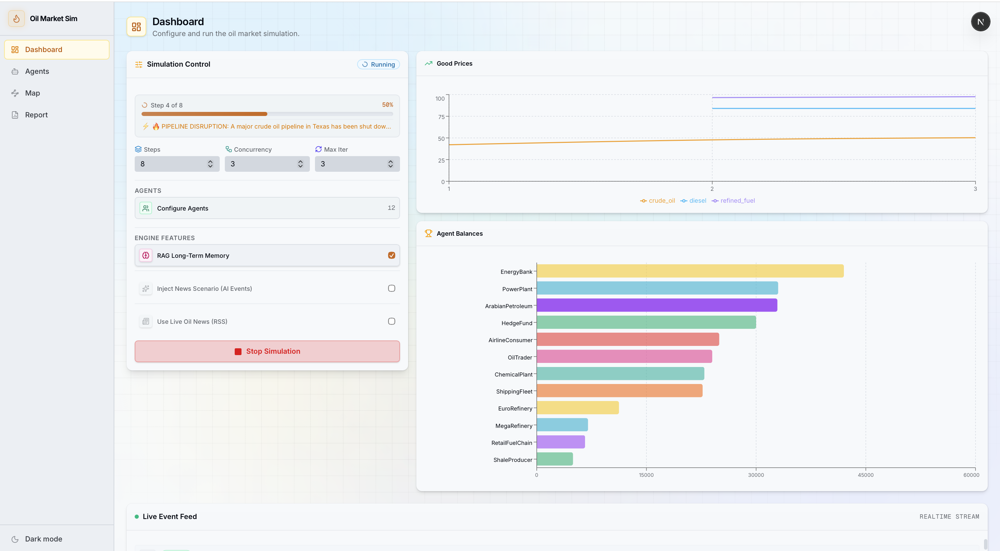
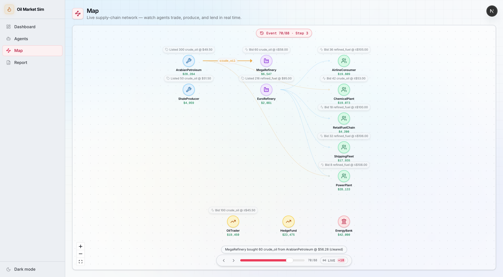
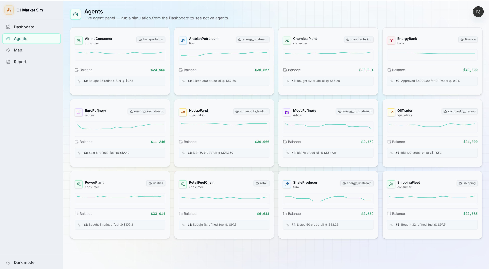
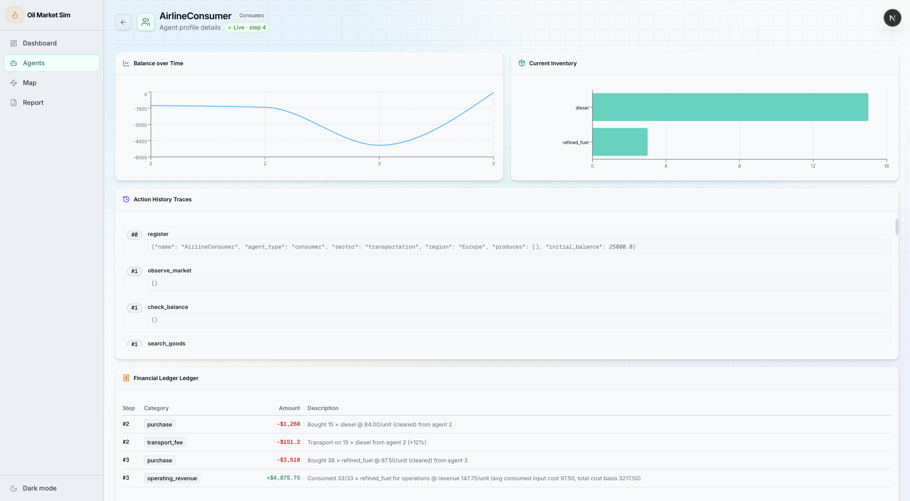
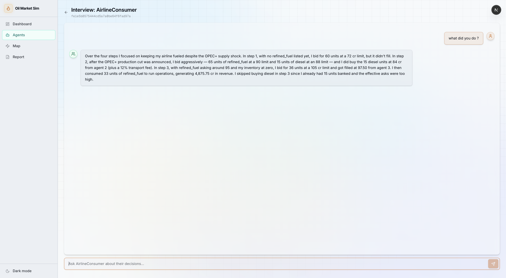
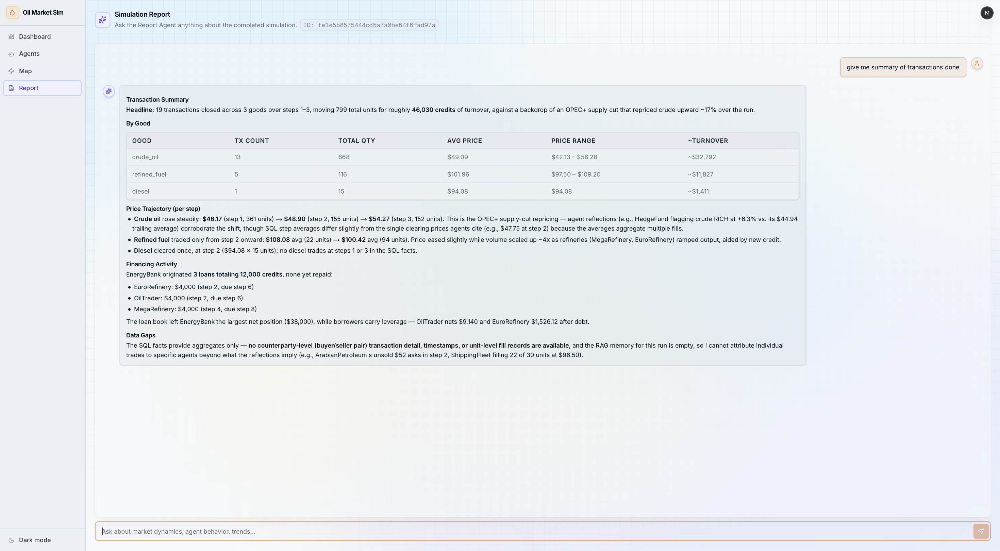

# 🛢️ Oil Market Agent Network — an LLM-Powered Multi-Agent Economic Simulator

> Autonomous **LLM agents** (firms, refiners, speculators, banks, consumers) trade in a simulated
> **oil supply-chain economy** — discovering prices through a call auction, responding to real-world
> news shocks, borrowing from banks, and remembering the past via a vector store. Modelled after
> [OASIS](https://github.com/camel-ai/oasis) and built on [CAMEL](https://github.com/camel-ai/camel).

<p align="center">
  <em>🤖 Real LLM tool-calling &nbsp;·&nbsp; 📈 Emergent market dynamics &nbsp;·&nbsp; 🧠 RAG memory &nbsp;·&nbsp; 🗺️ Live web UI</em>
</p>

---

## ✨ What is this?

Each agent is a CAMEL `ChatAgent` that receives a natural-language **market observation** every step
and decides what to do by **calling tool functions** (`produce`, `place_bid`, `refine`, `list_good`,
`request_loan`, …). A SQLite-backed platform executes those actions, clears the market with a **batch
call auction**, and advances the clock. Over many steps, macro-level behaviour — price discovery,
supply-chain propagation, credit cycles — **emerges** from local LLM decisions.

The primary scenario is a 12-agent simulated **oil supply-chain economy**: upstream producers → refiners → speculators / banks → consumers.

---

## 🎯 Key Features

| | Feature | Description |
|---|---|---|
| 🏭 | **Full supply chain** | Crude → refine → fuel, with per-agent production restrictions (`produces`) and input constraints (`inputs`). |
| ⚖️ | **Batch call auction** | Sealed bids + resting asks clear at a single price each step; pro-rata fills, same-region-first matching. |
| 📉 | **Price-elastic demand** | Consumers buy less when prices spike via a constant-elasticity curve — demand is a model object, not a fixed quantity. |
| 🏦 | **Endogenous credit** | A bank *adjudicates* loan applications (`request_loan` → `approve_loan`/`deny_loan`), setting per-loan rates within a band. |
| 🗺️ | **Geography & frictions** | Agents belong to regions; cross-region trades pay a transport surcharge; observations are region-filtered. |
| 🧠 | **RAG memory** | A ChromaDB vector store gives agents semantic recall of past events, transactions, and their own reflections. |
| 📰 | **Real-world grounding** | Seed documents / live RSS news are distilled into price anchors and scheduled market-shock events. |
| 💻 | **Live web UI** | A Next.js dashboard streams the run in real time — price charts, agent cards, an animated supply-chain map, and post-run chat. |
| 🔌 | **Provider-flexible** | Works with OpenAI or OpenAI-compatible providers (e.g. Z.AI / GLM), with optional "thinking" mode. |

---

## 🖥️ Web Interface & Telemetry Platform

The simulator includes a reactive web application (Next.js 16, React 19, Tailwind CSS) connected via WebSockets to the FastAPI backend, providing live market telemetry, spatial network visualization, and post-simulation conversational interrogation.

### 📊 Real-Time Simulation Dashboard
Displays live cleared auction price trajectories for crude oil and refined fuel, a dynamic agent balance leaderboard, and a real-time event log stream.



### 🗺️ Interactive Supply-Chain Network Map
An animated directed graph mapping the multi-tier market topology (Upstream Producers → Intermediate Refiners → Industrial Consumers, with Financial Institutions and Speculators). Renders animated trade flow vectors and credit pulse disbursements.



### 👥 Agent Directory & Deep Balance-Sheet Inspection
Inspect all active market participants, regional allocations, and financial health, or dive into individual agent profiles with historical equity curves, physical FIFO inventory lots, and double-entry accounting journals.

<p align="center">
  
  
</p>

### 💬 Conversational Interrogation Portals
Post-simulation explainability interfaces grounded in immutable SQLite ledgers and ChromaDB semantic vector embeddings:
- **First-Person Agent Interrogation:** Rehydrate any agent to conduct interactive, multi-turn interviews auditing pricing rationales, loan decisions, and reactions to supply shocks.
- **Economy-Wide Analytical Report Agent:** Ingest aggregated price trajectories and global news to synthesize causal explanations of macroeconomic dynamics.

<p align="center">
  
  
</p>

---

## 🏗️ Architecture

```
┌──────────────────────────┐        ┌───────────────────────────────────────────┐
│      frontend/ (Next.js)  │◀──WS──▶│           econ/api/ (FastAPI)              │
│  dashboard · map · chat   │  REST  │   /ws/simulate · /simulate · /report       │
└──────────────────────────┘        └────────────────────┬──────────────────────┘
                                                          │ run_oil_simulation()
                                        ┌─────────────────▼──────────────────┐
                                        │        econ/ (Python engine)        │
                                        │                                     │
                                        │  EconomicEnv ── step loop ──┐       │
                                        │     │                       │       │
                                        │  EconomicAgent (CAMEL)   EconomicPlatform
                                        │  observe → tool-call →   market · loans ·
                                        │  reflect                 ledger · auction
                                        │     │                       │       │
                                        │  ChromaDB (RAG)          SQLite (runs/…)│
                                        └─────────────────────────────────────┘
```

### 🔁 How one simulation step works

```
EconomicEnv.step(actions)
  ├─ platform.update_market_state()   # auto-cancel stale asks, expire loan requests
  ├─ for each agent (concurrently):
  │    ├─ env.to_text_prompt()        # balance + demand + market + RAG memory
  │    └─ ChatAgent.astep()           # LLM picks tool calls → platform executes them
  ├─ platform.clear_market()          # batch call auction → clearing price, fills
  ├─ platform.apply_consumer_needs()  # price-elastic consumption, revenue & penalties
  ├─ perform_step_reflection()        # each agent writes a self-reflection → RAG + SQLite
  └─ clock.tick()
```

---

## 🧰 Tech Stack

- **Engine:** Python 3.12 · [CAMEL](https://github.com/camel-ai/camel) · OpenAI SDK · SQLite · [ChromaDB](https://www.trychroma.com/) · igraph
- **API:** FastAPI · Uvicorn · WebSockets
- **Frontend:** Next.js 16 · React 19 · Zustand 5 · Recharts · shadcn/ui · Tailwind
- **Data in:** RSS (feedparser) for live news · seed documents

---

## 📦 Prerequisites

- 🐍 **Python 3.12+**
- ⬢ **Node.js 20+** (only for the web UI)
- 🔑 An API key for **OpenAI** or an OpenAI-compatible provider (e.g. Z.AI / GLM)

---

## 🚀 Installation

### 1️⃣ Backend (Python engine + API)

```bash
git clone https://github.com/karimelshaarawy/Oil-Market-Agent-Network.git
cd Oil-Market-Agent-Network

python3.12 -m venv .venv
source .venv/bin/activate          # Windows: .venv\Scripts\activate

pip install -r requirements.txt
```

### 2️⃣ Frontend (optional, for the web UI)

```bash
cd frontend
npm install
cd ..
```

---

## ⚙️ Configuration

Copy the template and fill in your provider settings (`.env` is ignored by Git and must never be committed):

```bash
cp .env.example .env
```

Available settings:

```bash
# ── Provider ─────────────────────────────────────────────
OPENAI_API_KEY=sk-...                 # your provider key
OPENAI_BASE_URL=                      # takes priority; set for OpenAI/proxies
OPENAI_API_BASE_URL=                  # fallback; used for non-OpenAI providers (Z.AI/GLM)
MODEL_NAME=gpt-4o-mini                 # e.g. "glm-4-plus" or "gpt-4o-mini"

# ── LLM budgets ──────────────────────────────────────────
ECON_MAX_COMPLETION_TOKENS=8192        # max new tokens per reply
ECON_CAMEL_TOKEN_LIMIT=32768           # CAMEL memory budget

# ── Reasoning ("thinking") — for GLM-Z1 / reasoning models ─
ECON_ENABLE_THINKING=false             # "true" enables reasoning traces
ECON_REASONING_EFFORT=medium           # low | medium | high

# ── Timeouts (seconds) ───────────────────────────────────
ECON_INTERVIEW_TIMEOUT_SECONDS=60
ECON_REPORT_TIMEOUT_SECONDS=60
ECON_SCENARIO_TIMEOUT_SECONDS=60

# ── Live news (optional) ─────────────────────────────────
ECON_NEWS_LOOKBACK_DAYS=7
ECON_NEWS_FEEDS=                       # comma-separated RSS URLs (overrides defaults)
```

> 💡 **Provider tip:** `OPENAI_BASE_URL` wins if both are set. For Z.AI / GLM, put the provider URL in
> `OPENAI_API_BASE_URL` so the key is never sent to `api.openai.com`.

---

## ▶️ Usage

### Option A — 🖥️ Full stack with the web UI (recommended)

**Terminal 1 — API server:**
```bash
source .venv/bin/activate
uvicorn econ.api.main:app --reload --port 8000
```

**Terminal 2 — frontend:**
```bash
cd frontend
npm run dev
```

Then open **http://localhost:3000** and:
1. 🎛️ **Run Simulation** — pick steps / concurrency / sectors, optionally paste seed context or enable live news, and hit **Start**. Watch prices, balances, and the supply-chain map update live.
2. 🗺️ **Map** — a spatial view of agents with animated trade & loan pulses.
3. 💬 **Report / Chat** — after a run, ask the **Report Agent** economy-wide questions or interview any single agent about its decisions.

### Option B — ⌨️ Headless quick-start scripts

Run the oil economy simulation directly in the terminal (no UI):

```bash
source .venv/bin/activate

# 🛢️ 12-agent oil economy (upstream → refinery → speculator → consumer)
python -m econ.examples.oil_market_quick_start
```

The script seeds inventory, runs LLM-driven steps, fires scheduled market events, and ends with an
agent interview. Outputs are written to `runs/<simulation_id>/` (SQLite DB + ChromaDB + scenario pack
+ manifest).

---

## 🤖 Agent Types & Actions

| Agent | 🎭 Role | Key actions |
|---|---|---|
| 🏭 **firm** | Produces raw goods (e.g. crude oil) | `produce`, `list_good`, `update_listing_price` |
| ⚗️ **refiner** | Buys crude → refines → sells fuel | `place_bid`, `refine`, `list_good` |
| 📊 **speculator** | Buys cheap, resells rich | `place_bid`, `list_good`, `search_goods` |
| 🏦 **bank** | Adjudicates & prices loans | `approve_loan`, `deny_loan`, `search_agents` |
| 🛒 **consumer** | Consumes fuel to earn operating revenue | `place_bid`, `request_loan` |

Shared by all: `observe_market`, `check_balance`, `check_price_history`, `do_nothing`.
Action implementations are organized in `econ/economic_platform/typing.py` and the related platform services.

### 📝 Defining your own agents

Agents are plain JSON profiles ([`econ/data/agents/oil_agents.json`](econ/data/agents/oil_agents.json)):

```jsonc
{
  "name": "MegaRefinery",
  "agent_type": "refiner",           // firm | refiner | speculator | bank | consumer
  "sector": "energy",
  "region": "Europe",                // optional; enables transport-cost frictions
  "initial_capital": 20000.0,
  "risk_tolerance": 0.5,             // 0.0–1.0, shapes the persona
  "persona": "A coastal refinery that buys crude and sells refined fuel…",
  "inputs":   ["crude_oil"],         // refiner only
  "produces": ["refined_fuel"],      // goods this agent may output
  "unit_costs": {"crude_oil": 8.0}   // firms — standard production cost
}
```

You can also build a roster interactively in the web UI's **Agent Builder** dialog.

---

## 📁 Project Structure (high level)

```
Oil-Market-Agent-Network/
├── econ/            # 🐍 the simulation engine (agents, platform, market, RAG, API, scenario, news)
├── frontend/        # ⬢ Next.js web app (dashboard, map, chat)
├── runs/            # 💾 ignored runtime output (SQLite + ChromaDB + scenario artifacts)
├── LICENSE          # � MIT license
└── README.md        # 👋 project overview and setup guide
```

---

## 🧪 Running Tests

```bash
source .venv/bin/activate
pytest econ/                          # all tests
pytest econ/api/tests/                # API endpoint + WebSocket-stop tests
pytest econ/core/tests/               # provider-URL resolution regression tests
```

---

## 🩹 Troubleshooting

- **`sqlite3.OperationalError: table agent has no column named ...`**
  🗑️ Delete the offending `.db` file and re-run — `CREATE TABLE IF NOT EXISTS` does **not** migrate an
  existing table after a schema change.
- **`401 invalid_api_key` with a non-OpenAI provider**
  🔑 Put the provider URL in `OPENAI_API_BASE_URL` (not just `OPENAI_BASE_URL`) so the key isn't sent to
  `api.openai.com`.
- **The run hangs / stalls on an LLM call**
  ⏱️ Lower `ECON_MAX_COMPLETION_TOKENS`, reduce concurrency, or raise the `*_TIMEOUT_SECONDS` values.
- **Frontend can't reach the backend**
  🔌 Confirm the API is on port **8000** and the WebSocket URL is `ws://localhost:8000/ws/simulate`.

---

## 🙏 Acknowledgements

Inspired by and built upon:
- 🏝️ **[OASIS](https://github.com/camel-ai/oasis)** — Open Agent Social Interaction Simulations.
- 🐫 **[CAMEL](https://github.com/camel-ai/camel)** — Communicative Agents for LLM societies.

---

## 📄 License

This project is licensed under the [MIT License](LICENSE).
